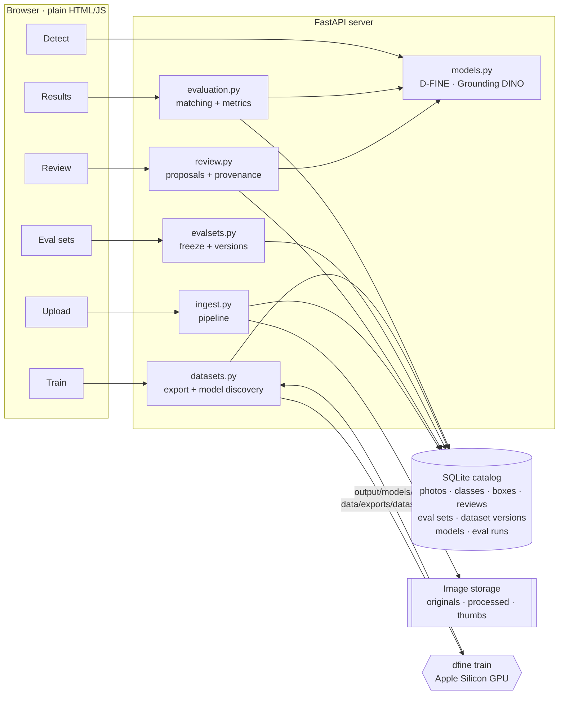

# Object Detector: from phone photos to a trained model

A self-hosted web app that covers the whole lifecycle of a custom object detector:
**collect photos → clean them → label them with model assistance → hold out fair eval sets →
train → score every model against every eval set → deploy the best one.**

It starts with shoes (sneakers, boots, heels) but is built for any object type: adding sofas or
chairs is a new class, not a new codebase. Everything runs locally; training and inference use
the Apple Silicon GPU.

```
 Upload ─▶ Pipeline ─▶ Catalog ─▶ Review ─▶ Eval sets ─▶ Train ─▶ Results ─▶ Detect
 (phones)  (normalize,  (SQLite)   (models    (frozen,    (D-FINE)  (models ×   (live
            dedupe)                 propose,   versioned)            eval sets)  model)
                                    you fix)
```

---

## Why this project

Training a detector is the easy part. Most of the work is in the data around it:

- **Photos from many phones are inconsistent.** HEIC vs JPEG, sideways pixels with a rotation
  tag, Display P3 vs sRGB color, GPS in the metadata, the same shot uploaded twice.
- **Labeling is slow.** Every box drawn by hand costs time, so models should propose boxes and a
  human should only correct them, while it stays clear which labels a person actually checked.
- **Evaluation is easy to get subtly wrong.** Eval photos leak into training, labels change
  after the fact, near-duplicate burst shots end up on both sides of the split, and a newly
  added class turns into fake false alarms on old test photos.

This app treats those problems as first-class features rather than afterthoughts.

---

## Features

### 📤 Upload and ingestion pipeline
Batch upload from a phone or laptop, with an optional product SKU per photo. Every upload runs
through a numbered, documented pipeline (`app/ingest.py`):

| Stage | Steps |
|---|---|
| **Ingest** | SHA-256 content hash as the photo's ID (exact duplicates are free to detect) · original stored untouched forever |
| **Normalize** | decode (incl. iPhone HEIC) · extract device/time metadata into the catalog · bake EXIF rotation into pixels · convert to sRGB using the embedded color profile · 8-bit RGB · JPEG · **strip all metadata, including GPS** |
| **Check** | minimum resolution · perceptual hash (DCT-based pHash) · **near-duplicate rejection**, so burst shots and re-sent copies never straddle train and eval |

Rejected photos keep their original file and a plain-English reason, so nothing is lost silently.

### 🏷️ Model-assisted review with full provenance
- On opening a photo, models **propose** boxes:
  - **your trained D-FINE model**, for the classes it knows
  - **Grounding DINO** (zero-shot, text-prompted) for everything else, so a brand-new class
    gets suggestions on day one
- Each class has editable **search words** for Grounding DINO. In testing, prompt wording changed
  which shoe type it guessed, so the prompt is part of the data, not hard-coded.
- **Every box records who made it and its status:**
  - `proposed` = a machine guess
  - `accepted` = confirmed by a person
  - `rejected` = deleted or corrected

  Fixing a proposed box rejects it and adds the corrected box under the reviewer's name, so the
  history shows exactly how often each model was right.
- Only `accepted` boxes are ever trained or evaluated on.
- **Coverage is tracked:** the catalog records which classes each photo was fully checked for,
  so "confirmed: no chair here" is distinguishable from "nobody looked for chairs".
- A canvas-based editor: draw, move and resize boxes, number keys for classes, keyboard-driven
  "save and next".

### 🧪 Eval sets that stay honest
- New eval sets start as a **random sample** of reviewed photos (optionally per category), which
  you then curate before **freezing**.
- **Freezing copies the labels too.** Correcting a box later in review can't silently change a
  frozen eval set, so scores from different months stay comparable. Changes go into a new
  version (`shoes-eval v2`).
- Photos in any eval set are automatically excluded from every training export.

### 🏋️ Reproducible training data
- **Dataset versions** are frozen snapshots of all reviewed, non-eval photos, exported in the
  exact layout D-FINE trains on:
  - images as **hard links**, so a new version costs no extra disk space
  - YOLO label files
  - a train/val split
  - a per-version `config.yaml` that records the class mapping
- A content fingerprint refuses to create a duplicate version when nothing has changed.
- Training starts from D-FINE weights pretrained on **Objects365 → COCO**, which has already
  seen many kinds of footwear, so it needs fewer labeled photos.
- Finished training runs are discovered automatically and linked back to the dataset version
  they were trained on.

### 📊 Results matrix and error analysis
- **Every model × every frozen eval set** in one table: F1 at a fixed confidence, with precision,
  recall and AP50, plus the change against the previous model. Regressions are flagged.
- **Coverage-aware scoring:** only classes the model knows *and* every eval photo was reviewed
  for are scored. Adding "chair" next month won't count correct chair detections on old shoe
  photos as false alarms.
- **Click any score** for a per-class breakdown and every photo the model got wrong, with boxes
  drawn as SVG overlays: found, missed, false alarm, wrong class.
- **One click switches the live model** behind the Detect page and the review proposals, with
  no restart.

---

## Architecture



- **Images and facts are separate.** Image files live behind a four-function storage interface
  (`save`, `load`, `exists`, `export_to`), written so that moving to S3-compatible object storage
  (e.g. DigitalOcean Spaces) only changes that one file.
- **The catalog is a single SQLite file.** Eleven tables hold every fact: where a photo came from,
  who labeled what, which photos are in which eval set version, what each model was trained on,
  and how it scored.

### Tech stack

| Layer | Tools |
|---|---|
| Detector | [D-FINE](https://huggingface.co/ArgoSA/D-FINE-seg) (DETR-style real-time detector) via `dfine-seg`, PyTorch on Apple **MPS** |
| Zero-shot labeling | [Grounding DINO](https://huggingface.co/IDEA-Research/grounding-dino-tiny) via Hugging Face `transformers` |
| Backend | Python 3.12, FastAPI, SQLite |
| Images | OpenCV, Pillow + `pillow-heif`, LittleCMS (color management) |
| Metrics | `torchmetrics` (COCO-style AP), custom box matching for per-photo error analysis |
| Frontend | Plain HTML/CSS/JS, `<canvas>` box editor, SVG overlays, no build step |
| Tooling | `uv` for environments and lockfile |

---

## Quick start

Requires macOS on Apple Silicon (training also runs on CUDA or CPU by changing `train.device`
in `config.yaml`) and [uv](https://docs.astral.sh/uv/).

```sh
uv sync                                     # create the environment from uv.lock
uv run python scripts/download_models.py    # Grounding DINO + D-FINE starting weights → models/
uv run python -m app                        # → http://127.0.0.1:8000
```

### The workflow

1. **Upload** (`/upload`): choose photos (JPEG, PNG, WebP or HEIC), optionally add a SKU per
   photo. Each one is normalized, checked and added to the catalog.
2. **Review** (`/review`): models propose boxes. Fix classes with `1`–`9`, drag to adjust,
   draw what's missing, and press `Enter` to save and move to the next photo.
3. **Eval sets** (`/eval`): create `shoes-eval`, curate the random sample, freeze it.
4. **Train** (`/train`): freeze a dataset version, then run the command the page shows:
   ```sh
   DFINE_SEG_CONFIG_DIR=$PWD/data/exports/dataset-v1 uv run dfine train
   ```
5. **Results** (`/results`): score each model on each eval set, inspect its mistakes, and choose
   the model the app uses.
6. **Detect** (`/`): drop in any photo.

---

## Project structure

```
app/
  main.py         web server: page routes + JSON API (every endpoint listed at the top)
  ingest.py       upload pipeline, steps numbered in comments
  catalog.py      SQLite schema (every column commented) + queries
  storage.py      image file storage (local now, S3-compatible later)
  models.py       D-FINE and Grounding DINO wrappers
  review.py       which model proposes what; turning a review into accepted/rejected boxes
  evalsets.py     eval set rules: random proposal, drafts, freeze, versions
  datasets.py     dataset versions: export for training, find trained models
  evaluation.py   box matching, precision/recall/F1/AP50, per-photo results
  static/         one HTML page per workflow step + shared CSS/JS
scripts/
  download_models.py
config.yaml       D-FINE training settings (each dataset version gets its own copy)
```

The code is written to be read: small modules, plain-English comments explaining *why*, and the
pipeline steps numbered so they can be followed top to bottom.

---

## Roadmap

- **Multiple uploaders:** accounts or personal upload links, then hosting on a cloud server with
  object storage
- **More ingest checks:** blur, under/over-exposure, screenshots
- **Slice tags on eval photos** (angle, setting, device), with scores broken down by slice
- **Review priority:** least-confident proposals first
- A phone-friendly review screen

## Acknowledgements

- [D-FINE](https://arxiv.org/abs/2410.13842) (Peng et al., 2024) and the
  [D-FINE-seg](https://github.com/ArgoHA/D-FINE-seg) training framework
- [Grounding DINO](https://arxiv.org/abs/2303.05499) (Liu et al., 2023)
- Interface ideas borrowed from FiftyOne, Label Studio and CVAT: views over a catalog,
  predictions kept separate from ground truth, and click-through error analysis
